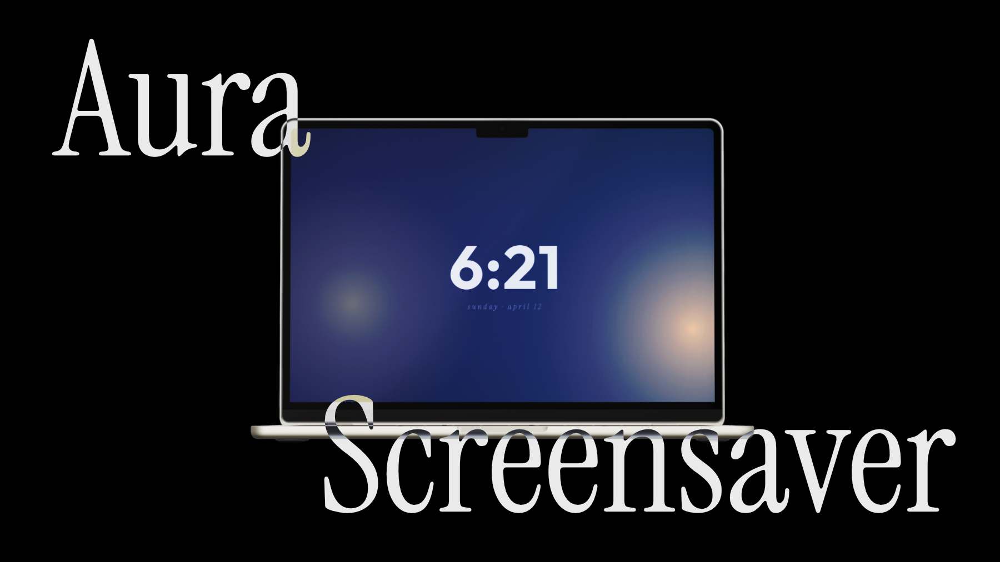
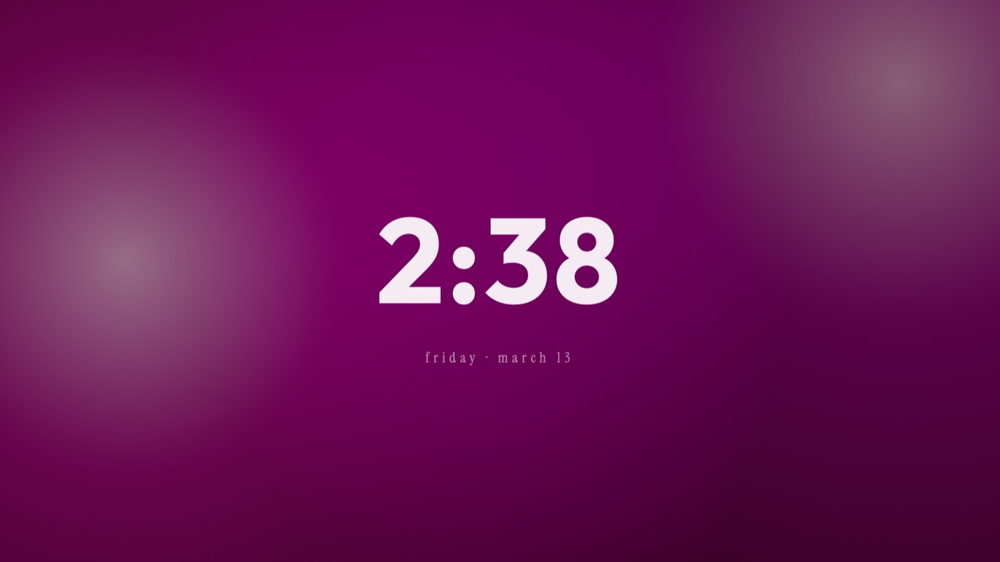
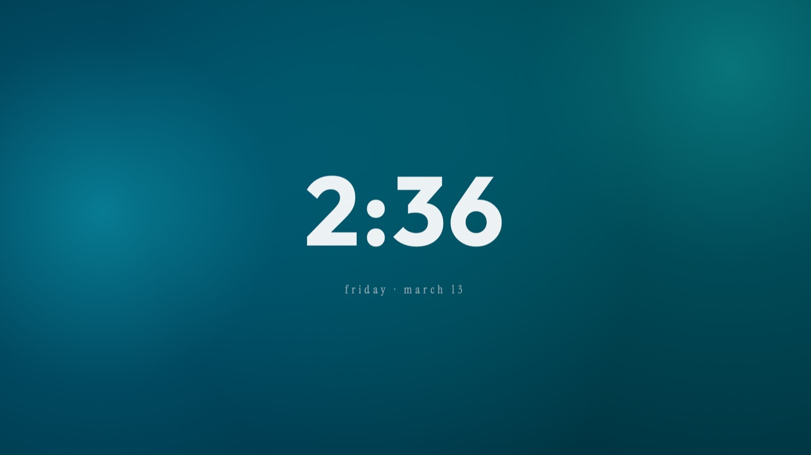
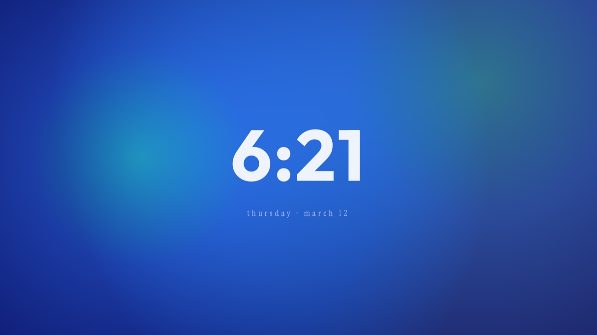

# Aura

Aura is a macOS screen saver with an animated gradient clock. It cycles through 16 color themes, with options to choose a theme or hide the clock.

## Preview

| Orchid | Aqua | Dark appearance |
| --- | --- | --- |
|  |  |  |

## Build from source

1. Open `aura.xcodeproj` in Xcode on a Mac.
2. Select the `aura` scheme and build the `aura.saver` product.
3. In Xcode, use **Product → Show Build Folder in Finder** to locate the built screen saver.

The project’s current Xcode build setting targets macOS 26.2. The generated screen saver bundle must be signed with your own Apple developer account if you need a signed build. The local developer-team setting has been removed from the shared project.

This repository contains source and preview artwork; it does not include a prebuilt installer. The project does not include a root license for the application source. The bundled Outfit and Instrument Serif font files are distributed under the SIL Open Font License 1.1; see [font license notices](licenses/FONTS-OFL.txt).
